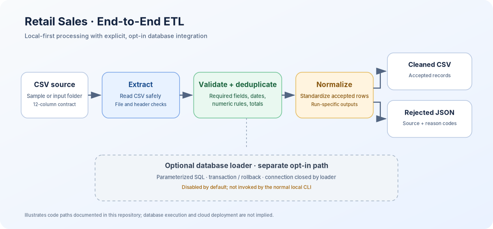
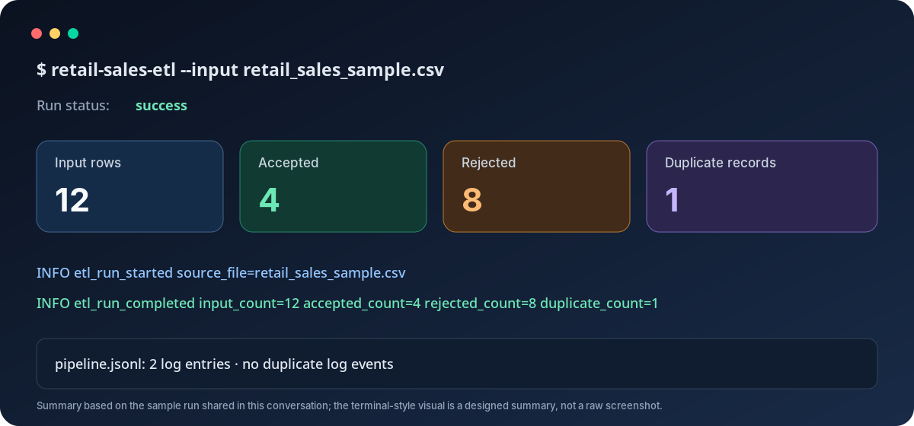

# Retail Sales — End-to-End Data Engineering Pipeline

A Python-based, local-first ETL pipeline that reads retail sales CSV files, validates and deduplicates rows, normalizes accepted records, and writes run-specific cleaned CSV and rejected JSON outputs. It also includes an explicitly invoked MySQL loading module, analytics SQL, unit tests, and a GitHub Actions workflow.

> **Safe by default:** the normal CLI processes local files only. It does not open a database connection, run SQL, deploy infrastructure, or upload data to the cloud.

   

## Contents

- [Architecture](#architecture)
- [Features](#features)
- [Technology stack](#technology-stack)
- [Quick start](#quick-start)
- [Run the pipeline](#run-the-pipeline)
- [Validation rules](#validation-rules)
- [Example run](#example-run)
- [Outputs](#outputs)
- [MySQL integration](#mysql-integration)
- [SQL analytics](#sql-analytics)
- [Tests and CI](#tests-and-ci)
- [Docker](#docker)
- [Configuration and security](#configuration-and-security)
- [Current limitations](#current-limitations)
- [Repository layout](#repository-layout)

## Architecture



**Local path:** CSV input → extraction → required-column checks → row validation and exact-duplicate detection → normalization → cleaned CSV + rejected JSON.

**Optional database path:** `src.load` exposes a separate explicit loader. The normal CLI does not call it, and database connections are disabled by default unless deliberately enabled in configuration.

## Features

- Accepts a single CSV file or a directory of CSV files.
- Checks required columns and validates required values, dates, quantities, prices, discounts, and calculated totals.
- Detects exact duplicate records and retains the first occurrence.
- Normalizes accepted records and writes a run-specific cleaned CSV.
- Captures rejected source records with stable reason codes in JSON.
- Produces structured JSON Lines logs and run metadata.
- Creates outputs exclusively to avoid overwriting previous run artifacts.
- Keeps database loading separate from ordinary local processing.
- Includes schema, verification and analytics SQL, unit tests, and a CI workflow.

## Technology stack

| Area | Tools |
|---|---|
| Language | Python 3.11 |
| Data processing | pandas |
| Configuration | python-dotenv, environment variables |
| Database integration (optional) | MySQL Connector/Python |
| Tests | pytest |
| CI | GitHub Actions |
| Container (optional) | Docker |
| Analytics | MySQL SQL |

## Quick start

### Requirements

- Python 3.11
- Dependencies listed in `requirements.txt`
- A MySQL server is **not** required for local ETL or unit tests.
- Docker is optional.

### Use an existing virtual environment

On macOS/Linux, from the repository root:

```bash
./.venv311/bin/python --version
./.venv311/bin/python -m pytest tests/unit -q
```

If you are setting up a new environment, create one and install the declared dependencies:

```bash
python3.11 -m venv .venv311
source .venv311/bin/activate
python -m pip install -r requirements.txt
python -m pytest tests/unit -q
```

Copy `.env.example` to `.env` only if you need local configuration overrides. Never commit `.env` or real credentials.

## Run the pipeline

Process the bundled sample file:

```bash
./.venv311/bin/python -m src.cli --input data/sample/retail_sales_sample.csv
```

Process all CSV files in a directory:

```bash
./.venv311/bin/python -m src.cli --input data/raw
```

For a safe isolated run that keeps generated output outside the repository:

```bash
tmpdir=$(mktemp -d)
PROCESSED_PATH="$tmpdir/processed" \
REJECTED_PATH="$tmpdir/rejected" \
LOG_FILE="$tmpdir/pipeline.jsonl" \
./.venv311/bin/python -m src.cli --input data/sample/retail_sales_sample.csv
```

The CLI prints a JSON result with status, run ID, input/accepted/rejected/duplicate counts, and output paths. The output directories and log destination can be configured through environment variables.

## Validation rules

The input contract requires these columns:

`order_id`, `customer_id`, `customer_name`, `product_id`, `product_name`, `category`, `order_date`, `quantity`, `unit_price`, `discount_percent`, `total_amount`, `payment_method`.

The pipeline validates required values and date/numeric formats, requires whole positive quantities and positive finite prices, constrains discounts to the inclusive range 0–100, and checks calculated totals within one cent. Exact duplicate rows are detected across supplied columns; the first occurrence is retained and later duplicates are rejected.

Rejected JSON entries contain a zero-based data-row index, ordered `reason_codes`, and the original source record. Non-finite numeric values are serialized safely rather than emitted as invalid JSON numbers.

## Example run

The included sample was run locally with the following result:



| Metric | Result |
|---|---:|
| Input rows | 12 |
| Accepted rows | 4 |
| Rejected rows | 8 |
| Duplicate rows detected | 1 |
| JSON log events | 2 (`etl_run_started`, `etl_run_completed`) |

The current sample intentionally contains invalid records so the rejection path can be demonstrated. These figures describe this sample, not a general production benchmark.

## Outputs

For each run, the pipeline creates unique filenames similar to:

```text
data/processed/retail_sales_sample_<run_id>_cleaned.csv
data/rejected/retail_sales_sample_<run_id>_rejected.json
```

The run ID is included in the filename and printed metadata. Output files are opened exclusively; collisions raise an error instead of overwriting an existing file. Configure `PROCESSED_PATH`, `REJECTED_PATH`, and optionally `LOG_FILE` to direct generated artifacts elsewhere.

## MySQL integration

`src.load.load_run_outputs` is a separate, explicit integration API. The implementation uses parameterized statements, performs the load in a transaction, rolls back failures, and closes connections it owns. The tests use fakes/mocks rather than requiring a live database.

**Database loading has not been verified against a live MySQL instance as part of this handoff.** Before any integration run, use a dedicated disposable project database, review the target and schema, and explicitly authorize the operation. Do not run the DDL against a production or shared database. `DB_CONNECTION_ENABLED` defaults to `false`.

## SQL analytics

- `sql/schema.sql` — table definitions, relationships, constraints, and indexes.
- `sql/verification.sql` — schema/contract verification queries.
- `sql/analytics.sql` — revenue and order volume, product/category metrics, customer rankings, payment summaries, and rejected-record reason counts.

The SQL files are included for review and future execution in a dedicated sandbox. Their presence does not mean they have been executed or that database result values have been validated.

## Tests and CI

The test suite covers CLI behavior, extraction, validation, normalization, reporting, loader behavior with fakes, and repository contracts. In the local environment used during project preparation, the reported result was **46 passed, 1 skipped**. The GitHub Actions workflow runs the unit tests on Python 3.11 for pushes, pull requests, and manual dispatch.

CI has not been triggered from this handoff. A local test result does not itself imply a successful GitHub Actions run.

## Docker

The optional Dockerfile packages the local CLI. It does not start MySQL or perform database loading.

```bash
docker build -t retail-sales-etl:local .
docker run --rm \
  -v "$PWD/data/processed:/app/data/processed" \
  -v "$PWD/data/rejected:/app/data/rejected" \
  retail-sales-etl:local --input /app/data/sample
```

Docker image build/run has not been verified during this handoff. Review output mounts and configuration before running it.

## Configuration and security

Common local settings include `INPUT_PATH`, `PROCESSED_PATH`, `REJECTED_PATH`, `LOG_LEVEL`, and optional `LOG_FILE`. Database settings are only relevant to the explicit loader. `STORAGE_BACKEND=local` is the only implemented storage backend. AWS variables are placeholders; there is no active S3 implementation or cloud deployment in this repository.

Before publishing to a public repository:

1. Confirm `.env` and credentials are not staged.
2. Inspect `git status --short` and review staged diffs.
3. Keep generated data only if it is intentionally safe to publish.
4. Avoid committing virtual environments, caches, local logs, or backup files.

## Current limitations

- Local CSV processing is implemented; S3/AWS storage is not implemented.
- Live MySQL integration and SQL execution have not been verified as part of this handoff.
- Docker build/run and GitHub Actions execution have not been verified as part of this handoff.
- The sample dataset is small and designed to exercise validation/rejection cases, not to benchmark throughput.

## Repository layout

```text
.
├── .github/workflows/tests.yml
├── data/
│   ├── sample/        # bundled CSV input
│   ├── processed/     # example cleaned output
│   └── rejected/      # example rejection artifacts
├── docs/assets/       # architecture and sample-run visuals
├── sql/               # schema, verification, analytics
├── src/
│   ├── cli.py         # command-line entry point
│   ├── config.py      # environment configuration
│   ├── extract.py     # CSV discovery and reading
│   ├── validation.py  # input contract and row checks
│   ├── transform.py  # normalization
│   ├── pipeline.py   # end-to-end local file flow
│   ├── reporting.py  # run summaries
│   ├── logging_config.py
│   └── load.py        # optional MySQL loader
├── tests/unit/
├── tests/integration/
├── Dockerfile
├── requirements.txt
└── README.md
```

## Interview-ready summary

> Built a Python ETL pipeline for retail sales CSV data with required-column checks, row-level validation, duplicate detection, normalized outputs, structured JSON logging, and run-specific rejected-record reports. Added a separate opt-in MySQL loader, SQL analytics assets, unit tests, Docker packaging, and GitHub Actions CI configuration. The local sample run processed 12 rows, accepted 4, rejected 8, and detected 1 duplicate.
